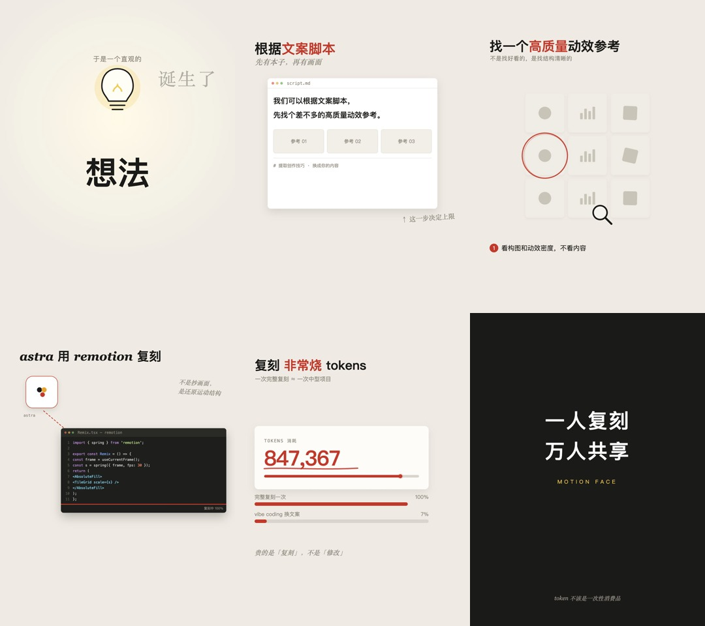

# remotion-motion-replica

一个 **Remotion 动效复刻起手工程**：纸感配色 + 假 UI 窗口 + 手绘描边 + 数据动画。
按 1080×1440 竖屏搭好，33 秒 6 段，改文案就能出片。



## 这套模板在做什么

不是"给文字加个淡入"。它复刻的是一条**杂志感知识动画**的完整视觉语言：

| 层 | 做法 |
|---|---|
| 版式 | 米白纸底 `#EFEBE4` + 墨色 `#1A1A18` + 强调红 `#C0392B` + marker 黄 `#F2C94C`；中文无衬线粗体，英文关键词切衬线斜体 |
| 假 UI | Mac 三圆点文件窗、代码编辑器（行号 / 语法高亮 / 进度条）、3×3 骨架缩略图 |
| 入场 | 逐字 `translateY 26→0` + spring；卡片 `translateY 140→0` + `rotate -6→-4°` 错峰弹入 |
| 强调 | marker `scaleX 0→1 origin left`；数字 `easeOutCubic` 滚动 + `tabular-nums`；SVG `stroke-dashoffset` 手绘圈与下划线 |
| 转场 | 硬切为主；冲击转场 `scale 1→1.35 + blur 0→8px`，持续 8-10 帧 |

## 快速开始

```bash
git clone https://github.com/luogao/remotion-motion-replica.git
cd remotion-motion-replica
npm install

# 预览（浏览器里拖时间轴）
npm run studio

# 渲染成片
npm run render
```

首次渲染 Remotion 会下载 93MB 的 `chrome-headless-shell`。国内网络慢的话，直接用本机 Chrome 跳过：

```bash
npx remotion render MotionFaceStudy out/study.mp4 \
  --browser-executable="/Applications/Google Chrome.app/Contents/MacOS/Google Chrome"
```

## 六段结构

| 段落 | 帧 | 内容 | 演示的动效 |
|---|---|---|---|
| S1 | 0-110 | 想法诞生 | 灯泡手绘 SVG + 逐字上浮 + 光晕呼吸 |
| S2 | 110-265 | 写脚本 | 文件窗弹入 + 打字机 + 闪烁光标 |
| S3 | 265-405 | 找参考 | 九宫格错峰缩放 + 放大镜扫过 + 手绘红圈 |
| S4 | 400-625 | 复刻成代码 | astra 卡片 + 虚线箭头 + 代码逐行 + 进度条 |
| S5 | 625-805 | 烧 token | 数字滚动 + 进度条 + 双对比条 + 手绘下划线 |
| S6 | 805-990 | 收尾 | 快推镜落定（scale + blur）+ 黑底 slogan |

## 改成自己的内容

**文案**：`src/MotionFaceStudy.tsx` 里搜中文，直接替换。每段一个 `const S1..S6`，互不依赖。

**配色 / 字号**：`src/components.tsx` 顶部 `C` 对象。

**时长**：改 `src/Root.tsx` 的 `durationInFrames`，再按比例调每段的起止帧。

**加一段**：复制一个 `Sx` 组件，在末尾的 `MotionFaceStudy` 里挂上 `frame >= A && frame < B`。

## 目录

```
src/
  index.ts              注册入口
  Root.tsx              Composition（1080×1440 / 30fps / 990 帧）
  MotionFaceStudy.tsx   六个场景 + 时间轴
  components.tsx        可复用件：FakeWindow / CodeEditor / ThumbGrid /
                        AstraLogo / DashArrow / Magnifier / RoughCircle /
                        RoughUnderline / typed / Caret
```

## 组件速查

```tsx
<FakeWindow title="script.md" x={150} y={360} w={780} h={600} delay={118}>
  ...
</FakeWindow>

<CodeEditor x={280} y={530} w={760} delay={430} progress={prog} />

<ThumbGrid x={254} y={430} start={280} />       // 3×3 骨架缩略图
<RoughCircle cx={344} cy={716} rx={104} ry={104} delay={340} />
<RoughUnderline x={134} y={716} w={430} delay={700} />

const text = typed("逐字打字的效果", frame, 132, 22);  // 22 字/秒
```

## 已知限制

- 手绘元素是 SVG 手写路径，不是真正的笔刷纹理；要更强的笔触感可以接 rough.js
- 代码编辑器的语法高亮是手工配色数组，换语言要改 `CODE`
- 只用系统字体（PingFang SC / Georgia / Menlo），跨平台渲染前先确认字体存在
- 没有音轨。需要配音就叠加 `<Audio>` 并按段落对齐

## License

MIT
